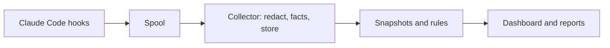

# Stillwatch

[](https://github.com/pranish-k/StillWatch/actions/workflows/ci.yml)
[](https://www.npmjs.com/package/stillwatch)
[](LICENSE)

A local flight recorder for coding agents: see what your agent did, what it touched, and what it left behind.

Agents do more work with less review, and people rarely read every command they approve.
After each Claude Code session, Stillwatch answers three questions without making you read the transcript:

- What did the agent do?
- Did it touch anything sensitive?
- What did it leave behind that could run or be read later?

## How it works

A tiny shell hook copies each Claude Code hook event into a local spool.
A background collector redacts secrets, stores events in SQLite, snapshots repository state and persistent locations at session start and end, and runs fixed detection rules.
A dashboard on `127.0.0.1` and a Markdown export show each session's timeline, risk level, and what remains.



Rules decide risk, not an AI model, and every finding links to the evidence behind it.
See [the architecture document](docs/architecture.md) for details.

## Status

Alpha, and looking for early testers.
It works with Claude Code only, on macOS and Linux, and it only observes: it never blocks or changes what the agent does.

## Try it

You need macOS or Linux, Node.js 22.13 or newer, and Claude Code 2.1.139 or newer.

```sh
npm install -g stillwatch
stillwatch install
```

Or run it without a global install: `npx stillwatch install`, and later `npx stillwatch open`.
`stillwatch install` adds Stillwatch's hooks to your Claude Code settings, keeps a backup, and starts the background collector.

Then:

1. Start a **new** Claude Code session and work as usual.
   Sessions that were already running are not recorded.
2. Run `stillwatch open` to see what the agent did in the dashboard.

For a two-minute test, make a throwaway repository and ask the agent for something that outlives the session:

```sh
mkdir ~/sw-test && cd ~/sw-test && git init && echo "# test" > README.md && git add . && git commit -m init
claude "Add a git pre-push hook that runs echo hello before every push."
```

After the session, `stillwatch open` should show it as **High** risk, with the hook under "What remains" and a link to the exact command that created it.

To remove Stillwatch and everything it recorded:

```sh
stillwatch uninstall --purge
npm uninstall -g stillwatch
```

The [setup guide](docs/setup.md) covers building from source, scopes, what install changes, and troubleshooting.

## Feedback

Open an [issue](https://github.com/pranish-k/StillWatch/issues) with what you expected and what happened, and include the output of `stillwatch status`.
Did a report tell you something you did not know?
Was an alert wrong or noisy?
Both answers help.
Recorded data never leaves your computer; if you share a report, read it first, because it is redacted but still contains file paths and commands.

## Commands

| Command | What it does |
| --- | --- |
| `stillwatch install` | Adds Stillwatch's hooks to Claude Code settings, with a backup |
| `stillwatch uninstall [--purge]` | Removes exactly those hooks; `--purge` also deletes all data |
| `stillwatch status` | Checks hooks, the collector, the spool, and the database |
| `stillwatch open` | Opens the local dashboard |
| `stillwatch sessions` | Lists sessions, riskiest first |
| `stillwatch report <id\|latest>` | Writes a redacted Markdown report |
| `stillwatch start`, `stillwatch stop` | Starts or stops the background collector |
| `stillwatch delete-data` | Deletes one session, old sessions, or everything |
| `stillwatch verify` | Checks event hash chains for edits |
| `stillwatch lab [--benchmark]` | Runs the attack lab, or the larger [detection benchmark](docs/benchmark/README.md), and prints a scorecard |

## What it cannot see

Stillwatch is a recorder and detector, not complete protection.
It does not capture network traffic, it sees only the file effects of scripts in the places it snapshots, and an agent running as you can tamper with it.
Read [the limits](docs/security/limits.md) before relying on a quiet report.

## Privacy

Everything stays on your computer: no network requests, no telemetry, and no cloud model.
Secrets are redacted before storage, and data is kept for 30 days by default.
See [privacy](docs/security/privacy.md).

## Documentation

- [Setup](docs/setup.md)
- [Architecture](docs/architecture.md) and [decisions](docs/decisions/README.md)
- [Detection benchmark](docs/benchmark/README.md)
- [Threat model](docs/security/threat-model.md), [limits](docs/security/limits.md), and [privacy](docs/security/privacy.md)
- [Development](docs/development.md)
- [Planning documents](docs/README.md#planning)

## License

[MIT](LICENSE)
