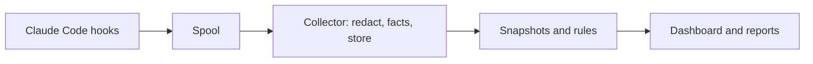

# Stillwatch

[](https://github.com/pranish-k/StillWatch/actions/workflows/ci.yml)

A local flight recorder for coding agents: see what your agent did, what it touched, and what it left behind.

Agents do more work with less review, and people rarely read every command they approve.
After each Claude Code session, Stillwatch answers three questions without making you read the transcript:

- What did the agent do?
- Did it touch anything sensitive?
- What did it leave behind that could run or be read later?

## How it works

A tiny shell hook copies each Claude Code hook event into a local spool.
A background collector redacts secrets, stores events in SQLite, snapshots repository state and persistent locations at session start and end, and runs fixed detection rules.
A dashboard on `127.0.0.1` and a Markdown export show each session's timeline, risk level, and what remains.



Rules decide risk, not an AI model, and every finding links to the evidence behind it.
See [the architecture document](docs/architecture.md) for details.

## Status

Pre-alpha.
Phase 1 is being built: Claude Code only, macOS and Linux, observation only.
It is not yet published to npm.

## Quick start

You need macOS or Linux, Node.js 22.13 or newer, Claude Code 2.1.139 or newer, git, and pnpm 12.

```sh
git clone https://github.com/pranish-k/StillWatch.git
cd StillWatch
pnpm install
pnpm build
node apps/cli/dist/stillwatch.mjs install
node apps/cli/dist/stillwatch.mjs open
```

Then use Claude Code as usual.
The [setup guide](docs/setup.md) covers scopes, what install changes, and troubleshooting.

## Commands

| Command | What it does |
| --- | --- |
| `stillwatch install` | Adds Stillwatch's hooks to Claude Code settings, with a backup |
| `stillwatch uninstall [--purge]` | Removes exactly those hooks; `--purge` also deletes all data |
| `stillwatch status` | Checks hooks, the collector, the spool, and the database |
| `stillwatch open` | Opens the local dashboard |
| `stillwatch sessions` | Lists sessions, riskiest first |
| `stillwatch report <id\|latest>` | Writes a redacted Markdown report |
| `stillwatch start`, `stillwatch stop` | Starts or stops the background collector |
| `stillwatch delete-data` | Deletes one session, old sessions, or everything |
| `stillwatch verify` | Checks event hash chains for edits |
| `stillwatch lab` | Runs the attack lab and prints a scorecard |

## What it cannot see

Stillwatch is a recorder and detector, not complete protection.
It does not capture network traffic, it sees only the file effects of scripts in the places it snapshots, and an agent running as you can tamper with it.
Read [the limits](docs/security/limits.md) before relying on a quiet report.

## Privacy

Everything stays on your computer: no network requests, no telemetry, and no cloud model.
Secrets are redacted before storage, and data is kept for 30 days by default.
See [privacy](docs/security/privacy.md).

## Documentation

- [Setup](docs/setup.md)
- [Architecture](docs/architecture.md) and [decisions](docs/decisions/README.md)
- [Threat model](docs/security/threat-model.md), [limits](docs/security/limits.md), and [privacy](docs/security/privacy.md)
- [Development](docs/development.md)
- [Planning documents](docs/README.md#planning)

## License

No license has been chosen yet.
The [project guideline](docs/planning/project-guideline.md) calls for choosing one before the public `0.1.0` release.
