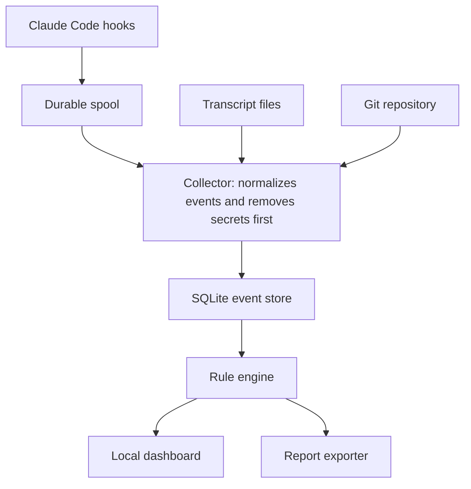

# Stillwatch: Architecture Decisions

The main architecture is a small local pipeline: hooks write to a durable spool, a collector redacts and stores events, and a dashboard reads the results. These decisions are proposed, so change them before coding if your review disagrees.

| ID | Decision | Status |
| --- | --- | --- |
| ADR-001 | Build a local-first app | Proposed |
| ADR-002 | Start with Claude Code only | Proposed |
| ADR-003 | Observe only in Phase 1 | Proposed |
| ADR-004 | Capture through hooks, using transcripts as backup | Proposed |
| ADR-005 | Write events to a spool before processing | Proposed |
| ADR-006 | Use a shared event format with agent adapters | Proposed |
| ADR-007 | Use TypeScript across the project | Proposed |
| ADR-008 | Use SQLite for local storage | Proposed |
| ADR-009 | Redact before storage | Proposed |
| ADR-010 | Use fixed rules for risk decisions | Proposed |
| ADR-011 | Use rule-based risk levels, not numeric scores | Proposed |
| ADR-012 | Use a local web dashboard | Proposed |
| ADR-013 | Bind to localhost with a token | Proposed |
| ADR-014 | Add a hash chain to events | Proposed |
| ADR-015 | Distribute as an npm package first | Proposed |

To change a decision, add a new record that replaces the old one. Keep the original, so the reasoning stays visible.

## System architecture

The hook path stays small and fast, while heavier work happens later in the collector. If the collector stops, events wait safely in the spool.

All Phase 1 data stays on the user's computer.

## Product shape and capture

### ADR-001: Build a local-first app

**Decision:** Store and process all Phase 1 data on the user's computer.

**Why:** Agent sessions can contain private code and secrets. Local storage makes the product easier to trust and avoids running a service.

**Alternatives:** A hosted dashboard would simplify team features, but it adds accounts, security duties, and hosting costs.

**Cost:** No cross-device view, and the app can't protect data from someone who controls the computer.

### ADR-002: Start with Claude Code only

**Decision:** Support one agent in Phase 1, while keeping the design ready for more.

**Why:** Claude Code has a detailed [hook system](https://code.claude.com/docs/en/hooks) that supplies most of the required events. One deep integration will reveal more than two shallow ones.

**Alternatives:** Starting with Claude Code and Codex would widen the audience, but it would slow the first proof.

**Cost:** Early testers must use Claude Code.

### ADR-003: Observe only in Phase 1

**Decision:** The app records and reports, but doesn't block actions.

**Why:** A false block interrupts real work, while a false alert costs a few seconds. Accuracy should be proven before enforcement.

**Alternatives:** Early blocking would make a stronger security claim, but a bug could stop sessions.

**Cost:** A harmful action is detected after it happens.

### ADR-004: Capture through hooks, with transcripts as backup

**Decision:** Use hook events as the main source, then compare them with transcripts and Git changes.

**Why:** Hooks provide structured events, including tool calls and config changes. Transcripts fill some gaps, although the [documentation notes](https://code.claude.com/docs/en/hooks) that transcript writes can lag behind the live session.

**Alternatives:** Reading transcripts alone is simpler, but gives less session context. System-level monitoring sees more, but needs elevated access and more specialized work.

**Cost:** Hooks may not reveal everything a script does internally. The app must show this as a limit.

### ADR-005: Write events to a spool before processing

**Decision:** The hook handler appends each event to a local file, then exits. The collector imports the file later.

**Why:** This keeps hooks fast and prevents event loss if the collector is down. Claude Code's `SessionEnd` hooks also have a [short time budget](https://code.claude.com/docs/en/hooks), so that path must be especially quick.

**Alternatives:** Sending events directly to a local server is simpler, but events could be lost when it isn't running.

**Cost:** The timeline may lag by a moment, and raw spool files need strict permissions and prompt deletion. Treat the spool as sensitive until events are redacted and imported.

### ADR-006: Use a shared event format with adapters

**Decision:** Convert agent-specific data into one internal format.

**Why:** Rules and reports stay independent of any one agent, which makes Codex support easier later.

**Alternatives:** Using Claude Code's format directly would be faster at first, but would spread its details through the code.

**Cost:** The design needs a small mapping layer. Keep the original event type for debugging.

## Storage, analysis, and interface

### ADR-007: Use TypeScript across the project

**Decision:** Build the command-line tool, collector, and dashboard in TypeScript.

**Why:** One language keeps a solo project simpler, and shared types reduce mismatches between the backend and dashboard.

**Alternatives:** Rust would give a stronger single binary and better performance, but it would slow early iteration. Python is quick to write, but packaging a local app is harder.

**Cost:** Users need a JavaScript runtime in Phase 1. If the core proves valuable, the hook handler can move to a compiled language later.

### ADR-008: Use SQLite for local storage

**Decision:** Store events, sessions, findings, and links in one local SQLite database.

**Why:** It needs no separate server, works well with structured queries, and is easy to back up or delete.

**Alternatives:** Plain JSON files are simple but hard to query. PostgreSQL is powerful, but too heavy for a local tool.

**Cost:** It suits one machine, so team sync will need a different design.

### ADR-009: Redact before storage

**Decision:** The collector removes secrets before writing to the database, UI, or reports.

**Why:** A monitoring app shouldn't create a second copy of the secrets it detects.

**Alternatives:** Encrypting everything keeps full detail, but still creates a valuable target and adds key management.

**Cost:** Some original values can't be recovered. Store the reason and location of a redaction, not the secret itself. Use known key patterns and entropy checks, and accept that redaction can miss unusual secrets.

### ADR-010: Use fixed rules for risk decisions

**Decision:** Findings come from code rules, not an AI model.

**Why:** Fixed rules are repeatable, testable, and can't be talked out of a result by a malicious log entry.

**Alternatives:** An AI classifier could judge more situations, but it adds cost, inconsistency, and prompt injection risk.

**Cost:** Rules miss some subtle behavior. AI summaries can help explain findings in Phase 2, without changing them.

### ADR-011: Use rule-based risk levels

**Decision:** Sessions are low, medium, high, or unknown. The session takes the highest finding's level.

**Why:** A person can understand and challenge a reason faster than a number.

**Alternatives:** A 0 to 100 score looks precise, but would imply accuracy the app can't justify.

**Cost:** It offers less ranking detail, so sort sessions within a level by time and finding count.

### ADR-012: Use a local web dashboard

**Decision:** Serve the interface from the collector and open it in a browser.

**Why:** It is quick to build, works on macOS and Linux, and avoids desktop packaging during validation.

**Alternatives:** Tauri or Electron feels more native, but adds packaging work. A terminal interface is lighter, but weaker for timelines and diffs.

**Cost:** It may feel less polished. Revisit a desktop app after the alpha.

## Security and distribution

### ADR-013: Bind to localhost with a token

**Decision:** Listen only on `127.0.0.1`, require a random local token, and check request origins.

**Why:** A malicious website could otherwise try to reach a local service. The dashboard contains sensitive information and needs protection.

**Alternatives:** A Unix socket limits access well, but makes browser access harder.

**Cost:** Setup is slightly more complex. The `stillwatch open` command should handle the token automatically.

### ADR-014: Add a hash chain to events

**Decision:** Each stored event includes a hash of its content and the prior event.

**Why:** Later edits to history become detectable, which supports the product's evidence promise.

**Alternatives:** Skipping this reduces work, but makes the log easier to rewrite without notice.

**Cost:** An agent running as the same user could rebuild the whole chain, so this is tamper evidence, not tamper proofing. Stronger protection needs a separate user or remote anchor.

### ADR-015: Distribute as an npm package first

**Decision:** Install through npm during the alpha.

**Why:** Claude Code users are likely developers, and npm removes most packaging work for a first test.

**Alternatives:** Homebrew and signed desktop installers are friendlier, but take longer to maintain.

**Cost:** Package supply-chain security matters. Use two-factor publishing, a lockfile, and minimal dependencies.

## Decisions to make later

| Topic | Revisit when |
| --- | --- |
| Open-source license | Before public release |
| AI summary provider | Phase 2 planning |
| Network capture method | After reviewing alpha needs |
| Lower-level monitoring | After hook limits are measured |
| Blocking policy | After alerts prove reliable |
| Desktop app | After repeat usage is proven |
| Team sync | When teams ask to pay |
