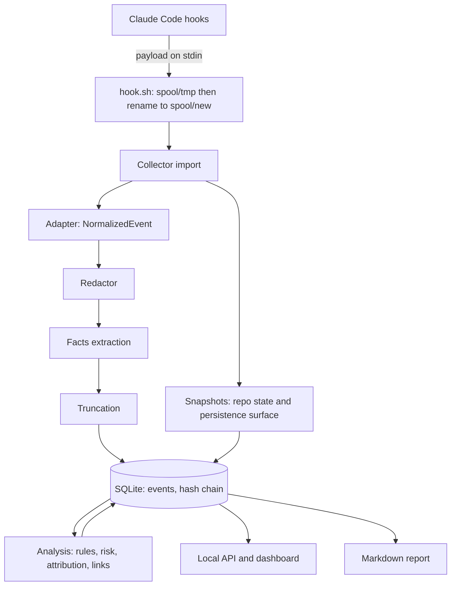

# Stillwatch architecture

This document describes how Phase 1 is built.
The planning documents in `docs/planning/` say what to build and why; the decision records in `docs/decisions/` record each technical choice.
The TypeScript contracts in `packages/schema/src` and each package's `src/index.ts` are the source of truth for shapes and signatures.

## Overview

Stillwatch is a local pipeline.
A tiny hook script copies each Claude Code hook payload into a durable spool.
A background collector imports the spool, redacts secrets, extracts facts, stores events in SQLite, takes repository snapshots, and runs fixed rules.
A dashboard on `127.0.0.1` and a Markdown exporter show the results.



Nothing leaves the computer.
There are no runtime dependencies: Node built-ins only (`node:sqlite`, `node:http`, `node:crypto`), bundled into one file.

## Packages

| Package | Responsibility | Depends on |
| --- | --- | --- |
| `packages/schema` | Shared types, constants, pure helpers (runs in Node and the browser) | none |
| `packages/adapter-claude` | Hook event spec, payload normalization, transcript reading | schema |
| `packages/redaction` | Secret redaction and data minimization | schema |
| `packages/storage` | SQLite store, migrations, hash chain, queries | schema |
| `packages/git-tracker` | Repository and persistence-surface snapshots and diffs | schema |
| `packages/facts` | Event facts, shell parsing, sensitive-path catalog | schema |
| `packages/rules` | Rules, session analysis, status, risk | schema, facts |
| `packages/reports` | Report model, summaries, Markdown, event descriptions | schema |
| `apps/collector` | Data dir, config, hook script, import pipeline, snapshots, analysis scheduling, HTTP API, auth | all packages |
| `apps/web` | React dashboard, built to static files | schema |
| `apps/cli` | The `stillwatch` command and the published npm package | collector, lab |
| `lab` | Attack lab scenarios and scorecard | collector |

Packages never reach into each other's internals; they import only from a package's `src/index.ts`.

## Capture

### The hook script

`stillwatch install` writes `~/.stillwatch/bin/hook.sh` and registers it in Claude Code settings in exec form, with no shell parsing:

```json
{ "type": "command", "command": "/bin/sh", "args": ["/Users/me/.stillwatch/bin/hook.sh", "claude-code", "PreToolUse"], "async": true }
```

The script is POSIX `sh` (ADR-016).
It writes stdin to `spool/tmp/<agent>.<Event>.<random>` with `mktemp` (mode 0600), renames the file into `spool/new/`, and exits 0.
It never writes to stdout, because stdout of some events becomes context for Claude.
It never exits 2, because exit 2 blocks actions.
It does not need Node, so a broken Node install cannot lose events.
For `SessionStart` and `UserPromptSubmit` it also checks the collector's pid file with shell built-ins and starts the collector in the background when it is not running.
Measured cost: about 9 ms per event, against about 60 ms for a Node hook.

### Hook events

The installed set lives in `CLAUDE_HOOK_EVENTS` (`packages/adapter-claude`).
High-frequency events run with `async: true`, so the agent never waits.
`SessionStart`, `UserPromptSubmit`, `Stop`, `StopFailure`, and `SessionEnd` run synchronously: they mark ordering boundaries, and `claude -p` kills async hooks at teardown.
`SessionEnd` gets no `timeout` field, because any value raises the shared 1.5 second budget for every `SessionEnd` hook.
Events that change Claude Code's behavior when hooked are never installed (`NEVER_INSTALL_EVENTS`): `WorktreeCreate`, `WorktreeRemove`, `PreModelSwitch`, `Elicitation`, `ElicitationResult`, `MessageDisplay`, `TeammateIdle`, and `Setup`.
The minimum Claude Code version is 2.1.139, the first with exec-form hooks; since 2.1.101 an unknown event name no longer invalidates a settings file.

Observed facts from real payloads (fixture `lab/fixtures/claude-code/real-session-2.1.318.json`):

- `InstructionsLoaded` can arrive before `SessionStart`, so any event may be a session's first.
- A background subagent reporting back arrives as `UserPromptSubmit` with a prompt starting `<task-notification>`; only user-typed prompts count as requests.
- A permission-denied call has a `PreToolUse` and no `PostToolUse`; `PostToolBatch` resolves it.
- `Read`, `Write`, and `Edit` results embed whole file contents, so stored copies are minimized.
- Subagent tool events carry `agent_id` and `agent_type`.

### The spool

The spool is maildir-style (ADR-017): one file per event, written to `tmp/` and renamed into `new/`.
A rename is atomic, so the collector never reads a half-written record, and concurrent sessions never interleave.
The receive time is the file's modification time.
The collector imports oldest first and deletes each file only after its event is committed.
A record imported twice (crash between commit and delete) is ignored by its unique `sourceId`.
A corrupt record is deleted and recorded as a capture gap; raw spool data is never kept longer than needed.

## Import pipeline

For each spool file, in the collector:

1. **Adapt**: `adaptClaudeRecord` turns the raw payload into a `NormalizedEvent`, or a failure with a reason.
2. **Redact**: the redactor replaces secrets in every string with `[REDACTED:<detector>:<fingerprint>]`.
   Fingerprints are HMAC-SHA256 with a local key, so equal secrets can be matched without storing them.
3. **Facts**: `extractFacts` records files, commands, URLs, domains, packages, signals, and secret references, from the full redacted event.
4. **Truncate**: `truncateJson` applies the limits in `LIMITS`, after redaction, so a cut can never expose part of a secret.
5. **Store**: `insertEvents` stores the event, its facts, and its redaction records in one transaction, extends the session's hash chain, and updates the session row.
6. **Snapshot**: when this is the first event of a session and it is fresh (at most `TIMING.snapshotFreshMs` old), take the start snapshot.
   On `session.end`, take the end snapshot.
7. **Schedule analysis** for the session, debounced.

## Snapshots

Snapshots record state at session start and end (ADR-021), as hashes only, never contents:

- For each repository (the session's cwd and directories added with `/add-dir`): HEAD, branch, effective hooks path, and an overlay of working tree differences from HEAD (path to blob hash), including untracked files that are not ignored.
- The persistence surface: shell profiles, ssh files, crontab output, launchd and systemd entries, agent configuration, memory files, `.git/hooks`, `.git/config`, and Stillwatch's own files.
  The catalog lives in `packages/facts`.

Comparing two snapshots gives the files that changed and the persistence entries that changed, independent of what the agent reported.
A change with no matching tool call becomes an unattributed change.
Git always runs with `execFile`, never a shell, and with every config-driven program execution disabled (see `packages/git-tracker/src/index.ts`).
A late or missing snapshot is a capture gap, stated in the report.

## Analysis

Analysis is a pure function, `analyzeSession(AnalysisInput): AnalysisResult` (`packages/rules`).
The collector gathers the input: events in display order, snapshots and their diff, recorded gaps, and context from earlier sessions.
The result holds findings, file changes with attribution, artifacts (what remains), links to other sessions, domains, unfinished work, sensitive access, stats, and the risk level with reasons.
The collector stores it with `saveAnalysis`, replacing the previous run, and stores a one-line summary from `summarizeSession`.

Risk is the highest finding severity (ADR-011).
With no medium or high finding, a critical capture gap makes the risk `unknown`.

Session status comes from `deriveSessionStatus`: `finished` after `SessionEnd`; `interrupted` when the last turn never finished and the session has been quiet for 30 minutes; `finished` with reason `no_session_end` after 24 quiet hours between turns; otherwise `active`.

## Storage

One SQLite database, `~/.stillwatch/stillwatch.db`, mode 0600, WAL mode.
Each session's events form a hash chain (ADR-014); `stillwatch verify` recomputes it.
This is tamper evidence, not tamper proofing: an agent running as the same user could rebuild the chain.
Derived rows (findings, file changes, artifacts, links, domains, analysis gaps) are replaced on each analysis.
Retention deletes whole sessions older than `retentionDays` (default 30).

## Local server and dashboard

The collector serves the API and the built dashboard on `127.0.0.1` only (default port 7391).
Authentication (ADR-022): `stillwatch open` creates a single-use login link signed with the local secret, valid for 120 seconds.
The dashboard exchanges it for a bearer token kept in `localStorage`, which is per origin and port, unlike cookies.
Every `/api` route except the exchange requires the token.
The server also rejects requests whose `Host` is not `127.0.0.1:<port>` or `localhost:<port>` (DNS rebinding), and checks `Origin` on state-changing requests.
Responses carry a strict Content Security Policy (`default-src 'none'; script-src 'self'; style-src 'self'; img-src 'self' data:; connect-src 'self'; base-uri 'none'; form-action 'none'; frame-ancestors 'none'`), `X-Content-Type-Options: nosniff`, `Referrer-Policy: no-referrer`, and `Cache-Control: no-store` for API responses.
The dashboard renders all session data as text and never uses `dangerouslySetInnerHTML`.

## Data directory

```text
~/.stillwatch/            0700 (override with STILLWATCH_HOME)
  config.json             0600  port, retention, auth secret, fingerprint key, install record
  stillwatch.db           0600  events and analysis
  spool/tmp/, spool/new/  0700  raw hook payloads awaiting import (sensitive until imported)
  bin/hook.sh             0700  capture hook
  backups/                0700  Claude Code settings backups from install
  run/collector.pid             single-instance lock
  logs/collector.log      0600  metadata only, never payload content
```

## Command-line interface

| Command | What it does |
| --- | --- |
| `stillwatch install [--scope user\|project\|local] [--project-dir <dir>] [--dry-run] [--force]` | Writes the hook script, backs up and edits Claude Code settings, creates config |
| `stillwatch uninstall [--scope ...] [--purge]` | Removes exactly the hook entries Stillwatch added; `--purge` also deletes data |
| `stillwatch status [--json]` | Hooks, hook script, collector, spool backlog, database, Claude Code compatibility |
| `stillwatch start`, `stop` | Start or stop the background collector |
| `stillwatch open [--no-browser]` | Starts the collector if needed and opens the dashboard with a login link |
| `stillwatch sessions [--json] [--limit <n>]` | Lists sessions in the review order |
| `stillwatch report <id\|latest> [--out <file>]` | Writes a redacted Markdown report |
| `stillwatch delete-data (--session <id> \| --older-than <days> \| --all) [--yes]` | Deletes data |
| `stillwatch verify [--session <id>]` | Verifies event hash chains |
| `stillwatch lab [--scenario <id>] [--json] [--keep]` | Runs the attack lab and prints a scorecard |

## Security invariants

These hold everywhere in the code base.

- Session data is untrusted: logs, transcripts, file names, commands, and tool output.
- No process is ever started through a shell, and no session data is ever placed in a command line.
- Secrets are redacted before storage, before logs, and before display.
- Nothing listens on anything but `127.0.0.1`, and nothing makes network requests.
- Files Stillwatch creates are mode 0600 and directories 0700.
- The capture hook never writes to stdout and always exits 0, so it cannot change what the agent does.
- Install edits only Stillwatch's own hook entries and keeps a backup; uninstall removes exactly those entries.
- Rules decide risk; nothing decides risk from text a model or an agent wrote.

## Performance budgets

| Path | Budget |
| --- | --- |
| Hook script per event | under 15 ms wall time on a laptop |
| Import of one event (adapt, redact, facts, truncate, store) | under 2 ms median |
| Start snapshot, typical repository | under 300 ms, never blocking the agent |
| Session analysis, 2,000 events | under 200 ms |
| Dashboard session list | under 100 ms server time for 10,000 sessions |
| Collector memory | under 100 MB resident |

## Testing

- Unit tests sit next to the code (`*.test.ts`); integration tests use temporary directories.
- Every rule has a positive test and a normal-use test.
- Tests never contain a literal real-looking secret: build fake secrets at runtime by concatenation, so secret scanners do not flag the repository.
- Tests never touch the real home directory, Claude Code settings, crontab, or network; they set `HOME` and `STILLWATCH_HOME` to temporary directories.
- The lab (`stillwatch lab`) runs end-to-end scenarios through the real hook script and pipeline.
