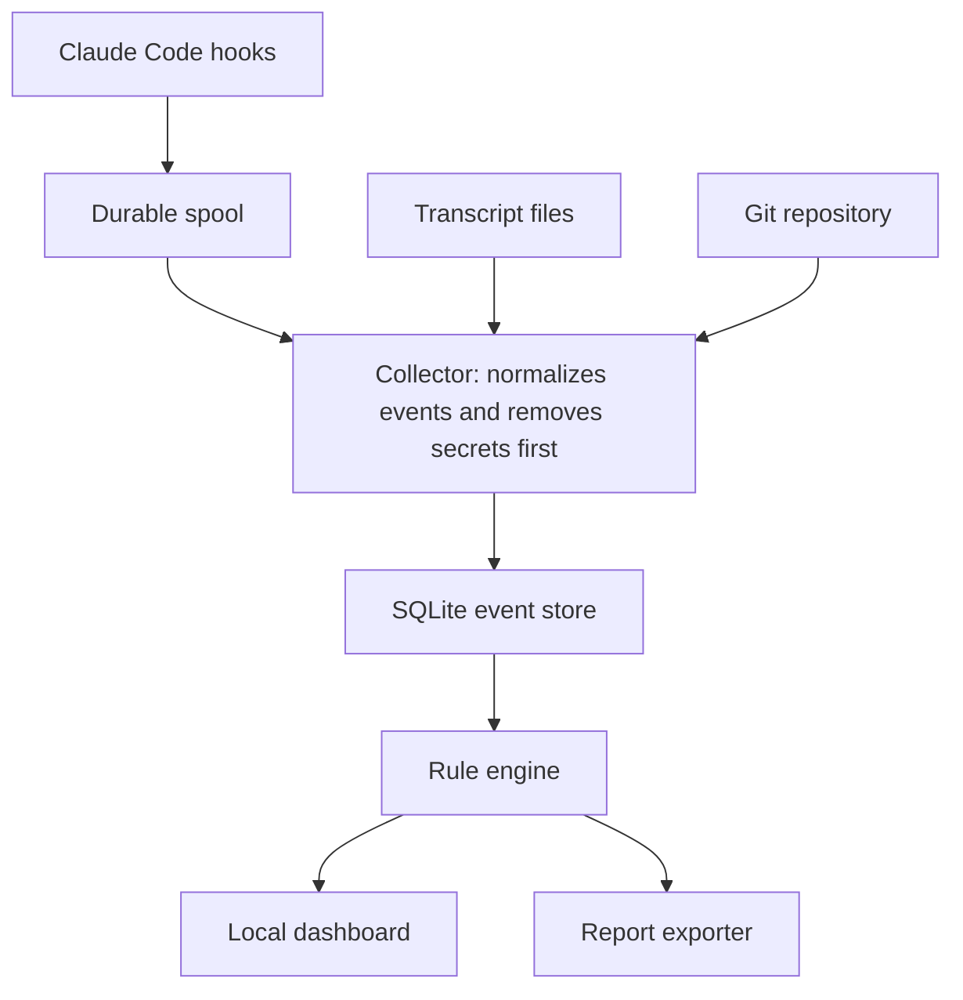

# Stillwatch: Architecture Decisions

The main architecture is a small local pipeline: hooks write to a durable spool, a collector redacts and stores events, and a dashboard reads the results.
ADR-001 to ADR-015 were proposed before coding and accepted during the Phase 1 build.
ADR-016 onward record choices made while building.
[The architecture document](../architecture.md) describes the system as built.

| ID | Decision | Status |
| --- | --- | --- |
| ADR-001 | Build a local-first app | Accepted |
| ADR-002 | Start with Claude Code only | Accepted |
| ADR-003 | Observe only in Phase 1 | Accepted |
| ADR-004 | Capture through hooks, using transcripts as backup | Accepted |
| ADR-005 | Write events to a spool before processing | Accepted, refined by ADR-017 |
| ADR-006 | Use a shared event format with agent adapters | Accepted |
| ADR-007 | Use TypeScript across the project | Accepted, refined by ADR-016 |
| ADR-008 | Use SQLite for local storage | Accepted |
| ADR-009 | Redact before storage | Accepted |
| ADR-010 | Use fixed rules for risk decisions | Accepted |
| ADR-011 | Use rule-based risk levels, not numeric scores | Accepted |
| ADR-012 | Use a local web dashboard | Accepted |
| ADR-013 | Bind to localhost with a token | Accepted, refined by ADR-022 |
| ADR-014 | Add a hash chain to events | Accepted |
| ADR-015 | Distribute as an npm package first | Accepted |
| ADR-016 | The capture hook is a POSIX shell script that only spools raw payloads | Accepted |
| ADR-017 | One file per event in a maildir-style spool | Accepted |
| ADR-018 | Use the built-in node:sqlite module | Accepted |
| ADR-019 | Zero runtime dependencies in one bundled file | Accepted |
| ADR-020 | Async hooks for frequent events, sync hooks for turn and session boundaries | Accepted |
| ADR-021 | Start and end snapshots instead of a live file watcher | Accepted |
| ADR-022 | Login link and bearer token for the dashboard, not cookies | Accepted |
| ADR-023 | Facts are separate from rules and computed at import | Accepted |
| ADR-024 | The capture hook starts the collector when it is not running | Accepted |
| ADR-025 | TypeScript 6 with type-aware lint rules | Accepted |
| ADR-026 | Minimum Claude Code version 2.1.139 | Accepted |
| ADR-027 | Redaction fingerprints and data minimization limits | Accepted |
| ADR-028 | User-scope install by default | Accepted |
| ADR-029 | pnpm workspace with internal TypeScript-source packages | Accepted |

To change a decision, add a new record that replaces the old one.
Keep the original, so the reasoning stays visible.

## System architecture

The hook path stays small and fast, while heavier work happens later in the collector.
If the collector stops, events wait safely in the spool.

All Phase 1 data stays on the user's computer.

## Product shape and capture

### ADR-001: Build a local-first app

**Decision:** Store and process all Phase 1 data on the user's computer.

**Why:** Agent sessions can contain private code and secrets.
Local storage makes the product easier to trust and avoids running a service.

**Alternatives:** A hosted dashboard would simplify team features, but it adds accounts, security duties, and hosting costs.

**Cost:** No cross-device view, and the app can't protect data from someone who controls the computer.

### ADR-002: Start with Claude Code only

**Decision:** Support one agent in Phase 1, while keeping the design ready for more.

**Why:** Claude Code has a detailed [hook system](https://code.claude.com/docs/en/hooks) that supplies most of the required events.
One deep integration will reveal more than two shallow ones.

**Alternatives:** Starting with Claude Code and Codex would widen the audience, but it would slow the first proof.

**Cost:** Early testers must use Claude Code.

### ADR-003: Observe only in Phase 1

**Decision:** The app records and reports, but doesn't block actions.

**Why:** A false block interrupts real work, while a false alert costs a few seconds.
Accuracy should be proven before enforcement.

**Alternatives:** Early blocking would make a stronger security claim, but a bug could stop sessions.

**Cost:** A harmful action is detected after it happens.

### ADR-004: Capture through hooks, with transcripts as backup

**Decision:** Use hook events as the main source, then compare them with transcripts and Git changes.

**Why:** Hooks provide structured events, including tool calls and config changes.
Transcripts fill some gaps, although the [documentation notes](https://code.claude.com/docs/en/hooks) that transcript writes can lag behind the live session.

**Alternatives:** Reading transcripts alone is simpler, but gives less session context.
System-level monitoring sees more, but needs elevated access and more specialized work.

**Cost:** Hooks may not reveal everything a script does internally.
The app must show this as a limit.

### ADR-005: Write events to a spool before processing

**Decision:** The hook handler appends each event to a local file, then exits.
The collector imports the file later.

**Why:** This keeps hooks fast and prevents event loss if the collector is down.
Claude Code's `SessionEnd` hooks also have a [short time budget](https://code.claude.com/docs/en/hooks), so that path must be especially quick.

**Alternatives:** Sending events directly to a local server is simpler, but events could be lost when it isn't running.

**Cost:** The timeline may lag by a moment, and raw spool files need strict permissions and prompt deletion.
Treat the spool as sensitive until events are redacted and imported.

**Refined by:** ADR-017, which writes one file per event instead of appending to a shared file.

### ADR-006: Use a shared event format with adapters

**Decision:** Convert agent-specific data into one internal format.

**Why:** Rules and reports stay independent of any one agent, which makes Codex support easier later.

**Alternatives:** Using Claude Code's format directly would be faster at first, but would spread its details through the code.

**Cost:** The design needs a small mapping layer.
Keep the original event type for debugging.

## Storage, analysis, and interface

### ADR-007: Use TypeScript across the project

**Decision:** Build the command-line tool, collector, and dashboard in TypeScript.

**Why:** One language keeps a solo project simpler, and shared types reduce mismatches between the backend and dashboard.

**Alternatives:** Rust would give a stronger single binary and better performance, but it would slow early iteration.
Python is quick to write, but packaging a local app is harder.

**Cost:** Users need a JavaScript runtime in Phase 1.
If the core proves valuable, the hook handler can move to a compiled language later.

**Refined by:** ADR-016, which makes the hook handler a POSIX shell script, so the hot path needs no JavaScript runtime.

### ADR-008: Use SQLite for local storage

**Decision:** Store events, sessions, findings, and links in one local SQLite database.

**Why:** It needs no separate server, works well with structured queries, and is easy to back up or delete.

**Alternatives:** Plain JSON files are simple but hard to query.
PostgreSQL is powerful, but too heavy for a local tool.

**Cost:** It suits one machine, so team sync will need a different design.

### ADR-009: Redact before storage

**Decision:** The collector removes secrets before writing to the database, UI, or reports.

**Why:** A monitoring app shouldn't create a second copy of the secrets it detects.

**Alternatives:** Encrypting everything keeps full detail, but still creates a valuable target and adds key management.

**Cost:** Some original values can't be recovered.
Store the reason and location of a redaction, not the secret itself.
Use known key patterns and entropy checks, and accept that redaction can miss unusual secrets.

### ADR-010: Use fixed rules for risk decisions

**Decision:** Findings come from code rules, not an AI model.

**Why:** Fixed rules are repeatable, testable, and can't be talked out of a result by a malicious log entry.

**Alternatives:** An AI classifier could judge more situations, but it adds cost, inconsistency, and prompt injection risk.

**Cost:** Rules miss some subtle behavior.
AI summaries can help explain findings in Phase 2, without changing them.

### ADR-011: Use rule-based risk levels

**Decision:** Sessions are low, medium, high, or unknown.
The session takes the highest finding's level.

**Why:** A person can understand and challenge a reason faster than a number.

**Alternatives:** A 0 to 100 score looks precise, but would imply accuracy the app can't justify.

**Cost:** It offers less ranking detail, so sort sessions within a level by time and finding count.

### ADR-012: Use a local web dashboard

**Decision:** Serve the interface from the collector and open it in a browser.

**Why:** It is quick to build, works on macOS and Linux, and avoids desktop packaging during validation.

**Alternatives:** Tauri or Electron feels more native, but adds packaging work.
A terminal interface is lighter, but weaker for timelines and diffs.

**Cost:** It may feel less polished.
Revisit a desktop app after the alpha.

## Security and distribution

### ADR-013: Bind to localhost with a token

**Decision:** Listen only on `127.0.0.1`, require a random local token, and check request origins.

**Why:** A malicious website could otherwise try to reach a local service.
The dashboard contains sensitive information and needs protection.

**Alternatives:** A Unix socket limits access well, but makes browser access harder.

**Cost:** Setup is slightly more complex.
The `stillwatch open` command should handle the token automatically.

**Refined by:** ADR-022, which defines how the token is issued and carried.

### ADR-014: Add a hash chain to events

**Decision:** Each stored event includes a hash of its content and the prior event.

**Why:** Later edits to history become detectable, which supports the product's evidence promise.

**Alternatives:** Skipping this reduces work, but makes the log easier to rewrite without notice.

**Cost:** An agent running as the same user could rebuild the whole chain, so this is tamper evidence, not tamper proofing.
Stronger protection needs a separate user or remote anchor.

### ADR-015: Distribute as an npm package first

**Decision:** Install through npm during the alpha.

**Why:** Claude Code users are likely developers, and npm removes most packaging work for a first test.

**Alternatives:** Homebrew and signed desktop installers are friendlier, but take longer to maintain.

**Cost:** Package supply-chain security matters.
Use two-factor publishing, a lockfile, and minimal dependencies.

## Decisions made during the build

### ADR-016: The capture hook is a POSIX shell script that only spools raw payloads

**Decision:** The hook Claude Code runs is `~/.stillwatch/bin/hook.sh`, a POSIX `sh` script registered in exec form.
It copies the payload from stdin into the spool and exits 0, without parsing it.

**Why:** It measured about 9 ms per event, against about 60 ms for a Node hook.
No Node runs on the hot path, so a Node upgrade or version switch cannot lose events.
The hook never parses untrusted input, which keeps its attack surface tiny.
Exec form passes arguments without shell parsing.

**Alternatives:** A Node hook keeps one language but costs about 60 ms per event.
A compiled binary is faster still, but needs a build for each platform.

**Cost:** The receive time is the spool file's modification time.
All parsing moves to the collector.
It needs POSIX `sh` and `mktemp`, so it supports macOS and Linux only, matching Phase 1.

### ADR-017: One file per event in a maildir-style spool

**Decision:** The hook writes each event to its own file in `spool/tmp/`, then renames it into `spool/new/`.
The collector imports `spool/new/` oldest first and deletes each file after its event is committed.

**Why:** A rename is atomic, so the collector never reads a partial record.
Concurrent sessions never interleave, no read offsets are needed, and a record imported twice is ignored by its file name.

**Alternatives:** An append-only JSONL file per session needs read offsets, rotation, and handling of partial last lines.

**Cost:** Many small files pile up while the collector is down, and each import lists a directory.

### ADR-018: Use the built-in node:sqlite module

**Decision:** Store data through Node's built-in `node:sqlite` module.

**Why:** There is no native addon to compile and no install script to run, which keeps installs fast and dependency-free.

**Alternatives:** `better-sqlite3` is mature and fast, but needs a native build or prebuilt binary and an install script.

**Cost:** It requires Node 22.13 or newer.
Node still prints an experimental warning for the module, which Stillwatch filters.
Only the API available in Node 22.13 can be used.

### ADR-019: Zero runtime dependencies in one bundled file

**Decision:** The published package has no runtime dependencies.
esbuild bundles the CLI, collector, lab, and internal packages into one file, next to the built dashboard.

**Why:** Fewer dependencies mean a smaller supply chain to trust (ADR-015), faster installs, and code users can read.

**Alternatives:** A normal dependency tree saves writing code, but every dependency is another party to trust.

**Cost:** HTTP routing, argument parsing, and validation are written by hand.

### ADR-020: Async hooks for frequent events, sync hooks for turn and session boundaries

**Decision:** Tool, permission, subagent, and other frequent events use `async: true`.
`SessionStart`, `UserPromptSubmit`, `Stop`, `StopFailure`, and `SessionEnd` run synchronously, and `SessionEnd` gets no `timeout` field.

**Why:** Async hooks add no latency to tool calls.
Sync hooks mark ordering boundaries, and `claude -p` kills async hooks still running at teardown, which would lose a session's final events.
Any `timeout` on a `SessionEnd` hook raises the shared 1.5 second budget for every `SessionEnd` hook.

**Alternatives:** All sync hooks add latency to every tool call.
All async hooks can lose final events in headless mode.

**Cost:** Async events can arrive slightly out of order, so storage always orders a tool result after its call.

### ADR-021: Start and end snapshots instead of a live file watcher

**Decision:** At session start and end, record repository state and the persistence surface as hashes: HEAD, branch, hooks path, the hashes of working tree changes, and hashes of shell profiles, scheduled tasks, agent configuration, memory files, and Stillwatch's own files.
Compare the two snapshots to find what changed.

**Why:** It is independent evidence that catches changes made inside scripts that hooks cannot see into.
It stores no copy of file contents (ADR-009), and it needs no long-running watcher over the home directory.

**Alternatives:** A Chokidar file watcher gives exact timing, but costs resources, can miss events, and only works while running.
Copying file contents allows content diffs, but stores secrets.

**Cost:** There is no exact timing for changes within a session, except when a tool call explains them.
Reports show paths, change kinds, and line counts where git provides them, not content diffs.

### ADR-022: Login link and bearer token for the dashboard, not cookies

**Decision:** `stillwatch open` creates a single-use login link signed with a local secret and valid for 120 seconds.
The dashboard exchanges it for a bearer token, valid for 30 days, kept in `localStorage` and sent in the `Authorization` header.

**Why:** Browsers share cookies for `127.0.0.1` across ports, so any other local web server the user visits would receive a cookie.
`localStorage` is scoped to the origin, including the port.
Without ambient credentials, cross-site request forgery has nothing to use.

**Alternatives:** A cookie session is simpler, but leaks across local ports.
A token in the URL ends up in browser history.

**Cost:** A token in `localStorage` is readable by any script on the page, so the dashboard must stay free of script injection: a strict Content Security Policy, no inline scripts, and session data rendered only as text.

### ADR-023: Facts are separate from rules and computed at import

**Decision:** `packages/facts` turns each event into facts (files, commands, URLs, domains, packages, signals, and secret references) when the event is imported, before truncation.
`packages/rules` decides what the facts mean.

**Why:** Facts are objective and change rarely, while rules change often.
Computing facts before truncation sees the full content, such as injected text deep in a fetched page, without storing it.

**Alternatives:** Rules could parse raw events at analysis time, but that needs full content stored.

**Cost:** Facts are versioned, and improving fact extraction does not change facts already stored.

### ADR-024: The capture hook starts the collector when it is not running

**Decision:** For `SessionStart` and `UserPromptSubmit`, the hook checks the collector's pid file with shell built-ins and starts the collector in the background when it is not running.

**Why:** Install and forget: start snapshots need a running collector, and the check costs no measurable time.

**Alternatives:** A launchd or systemd unit runs the collector at login, but needs platform-specific installs.
Starting it by hand means missed start snapshots.

**Cost:** A background process runs that the user did not start by hand.
`stillwatch status` and `stillwatch stop` make it visible and controllable.

### ADR-025: TypeScript 6 with type-aware lint rules

**Decision:** Use TypeScript 6 with typescript-eslint's strict type-checked rules.

**Why:** Type-aware rules, such as no floating promises and no unsafe `any`, catch real bugs in a long-running collector.
typescript-eslint supports TypeScript versions below 6.1.

**Alternatives:** The TypeScript 7 native compiler typechecks faster, but has no type-aware linting yet.
Biome and oxlint are faster linters with fewer type-aware rules.

**Cost:** Typechecks are slower than with TypeScript 7.
Revisit when typescript-eslint supports TypeScript 7.

### ADR-026: Minimum Claude Code version 2.1.139

**Decision:** `stillwatch install` requires Claude Code 2.1.139 or newer, unless forced with `--force`.

**Why:** 2.1.139 is the first version with exec-form hooks (`args`), which Stillwatch uses so no shell parses arguments.
It is also later than 2.1.101, since which an unknown hook event name no longer invalidates a settings file.

**Alternatives:** Shell-form hooks would support older versions, but every path would need shell quoting.

**Cost:** Older Claude Code versions are refused by default.

### ADR-027: Redaction fingerprints and data minimization limits

**Decision:** Each redacted secret is replaced by a marker that carries an 8 character fingerprint, from HMAC-SHA256 with a local key.
After redaction, stored data is cut to fixed limits: 8 KiB for tool result strings, 16 KiB for prompts, and 64 KiB for each event.

**Why:** Fingerprints let rules connect a secret that was read with the same secret being sent, without storing it.
The agent's own transcript keeps the full record, so Stillwatch only needs enough to explain events.

**Alternatives:** Encrypting full payloads keeps detail, but creates a valuable target and needs key management (ADR-009).

**Cost:** A fingerprint of a very short secret is only as safe as the local key.
Stored previews can miss context that only the transcript has.

### ADR-028: User-scope install by default

**Decision:** `stillwatch install` adds hooks to the user settings file, `~/.claude/settings.json` or `$CLAUDE_CONFIG_DIR/settings.json`, so every project is covered.
Project and local scopes are available with `--scope`.

**Why:** Monitoring is only useful when it covers every session, and a session in an unmonitored project is a blind spot.

**Alternatives:** Project scope limits what the install touches, but leaves other projects unmonitored.

**Cost:** It edits a file the user owns.
Install takes a backup first, and uninstall removes exactly the entries Stillwatch added.

### ADR-029: pnpm workspace with internal TypeScript-source packages

**Decision:** The repository is a pnpm workspace.
Internal packages export their TypeScript sources directly, Vitest and esbuild consume them without a per-package build step, and dependency install scripts are blocked.

**Why:** pnpm's content-addressable store makes installs fast, and its strict layout keeps dependency boundaries honest.
Exporting sources removes build steps between packages.

**Alternatives:** npm workspaces need no extra tool, but hoist dependencies, which hides missing declarations.
Building each package separately adds steps and stale outputs.

**Cost:** Contributors need pnpm 12.
Code runs through Vitest or after bundling, not directly with Node.

## Decisions to make later

| Topic | Revisit when |
| --- | --- |
| Open-source license | Before public release |
| AI summary provider | Phase 2 planning |
| Network capture method | After reviewing alpha needs |
| Lower-level monitoring | After hook limits are measured |
| Blocking policy | After alerts prove reliable |
| Desktop app | After repeat usage is proven |
| Team sync | When teams ask to pay |
