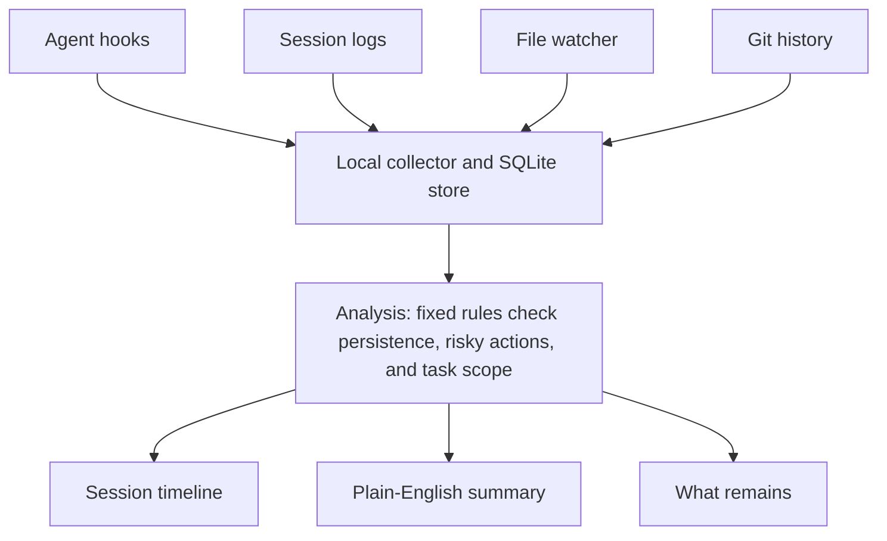

# Stillwatch: Project Brief

Nov 2, 2026

## Summary

Build a local app that records what coding agents actually did, explains it in plain English, and flags changes that could outlive the session.
Think of it as a flight recorder for agents, with antivirus-style alerts added later.

The problem is simple: agents now do more work with less human review, and people often don't read what they approve.
Developers need to see what happened without reading hundreds of commands.

The bottom line: a useful open-source version is realistic for one developer in about 2 to 4 months part-time.
A paid company is less certain, because large security vendors already sell related products to enterprises.

## Goal

The goal is to answer one question quickly: what did my agent do, and should I care?
The first user is a solo developer or small team using Claude Code or Codex.

The first release should do four things:

- Show a timeline of each agent session.
- Summarize what changed in plain English.
- Highlight persistent changes such as hooks, CI files, cron jobs, memory notes, and startup files.
- Flag actions that appear to go beyond the original request.

These are out of scope at first: automatic blocking, enterprise fleet management, cloud accounts, browser agents, and claims of full protection.
Start by showing people the truth, then add enforcement if they ask for it.

## The commitment

Expect 10 to 15 hours a week for about 4 months to reach a public open-source release.
These are planning estimates, not sourced figures.

| Stage | Time | Likely cash cost | What you are signing up for |
| --- | --- | --- | --- |
| Personal prototype | 2 to 4 weeks | $0 to $50 a month | Capturing sessions and building a simple timeline |
| Useful local app | 2 to 3 months | $20 to $100 a month | Persistence detection, summaries, testing, and packaging |
| Public release | 1 to 2 more months | $50 to $200 a month | Documentation, early users, bug fixes, and privacy review |
| Paid product | 12 months or more | Depends on the path | Support, security reviews, customer calls, and constant integration updates |

The ongoing burden is keeping up with agent tools.
When Claude Code or Codex changes a log format or hook, your integration may need an update.

## Prerequisites

You need basic full-stack development skills and regular access to the agents you want to monitor.
You don't need kernel or virtualization expertise for the first version.

**Skills**

- TypeScript or Python, plus Git
- Reading JSON and JSONL logs
- Basic command-line and file permission knowledge
- Simple UI development
- Basic security thinking, especially around secrets and untrusted text

**Setup**

- A Mac or Linux computer
- VS Code
- Claude Code, Codex, or both
- Test repositories with no real secrets
- A small set of sample sessions, including deliberately risky ones

## How it works

The app collects evidence from several places, analyzes it locally, and gives you three ways to review a session.
It starts by observing, not blocking.

Using several sources matters because an agent's own log may not show everything.
The app compares what the agent reported with what actually changed.

Phase 1 replaces the file watcher with snapshots of repository state and persistent locations at session start and end ([ADR-021](../decisions/README.md#adr-021-start-and-end-snapshots-instead-of-a-live-file-watcher)).
The [architecture document](../architecture.md) shows the pipeline as built.

## Stack and glossary

Start with TypeScript, SQLite, and existing agent logs.
They are enough for a useful local app, and you can add lower-level monitoring later.

| Term | What it means | Purpose here | Build or reuse |
| --- | --- | --- | --- |
| Agent hook | A command an agent tool runs at a set moment | Captures prompts, tool calls, and session events | Reuse |
| [Claude Code hooks](https://code.claude.com/docs/en/hooks) | Claude Code's lifecycle events | Provide tool calls, config changes, file changes, and transcript paths | Reuse |
| Codex hooks and rollout files | Codex events and JSONL session logs | Provide [session data for Codex](https://docs.entire.com/agents/codex) | Reuse |
| JSONL | A file with one JSON record per line | Common format for session logs | Parse |
| Collector | A small local background service | Gathers events from each source | Build |
| SQLite | A database stored in a local file | Stores sessions and events without a server | Reuse |
| File watcher | A service that reports file changes | Catches changes that logs may miss | Replaced in Phase 1 by start and end snapshots (ADR-021) |
| Git diff | A comparison of file changes | Shows what actually changed in a repository | Reuse |
| Rule engine | Fixed checks over recorded events | Flags risky behavior without relying on a model | Build |
| Scope check | A comparison of the request and the actions | Highlights work beyond what was asked | Build |
| Redaction | Hiding secrets in stored data | Reduces the risk of leaking credentials | Build |
| Summary model | An AI model that writes plain-English summaries | Makes long sessions easy to review | Reuse, with local or opt-in API use |
| Local web UI | A dashboard running on your computer | Shows timelines, alerts, and summaries | Build |
| Tauri or Electron | Frameworks for desktop apps | Package the dashboard later | Reuse later |
| eBPF or Endpoint Security | Lower-level system monitoring | Capture activity outside agent hooks in a later version | Reuse later |

## Reporting model

The main report is per session, because a session is the clearest unit of work and the easiest to review.
Agent and project views come later.

| View | Answers | When to build |
| --- | --- | --- |
| Session report | What happened this time, and should I check anything? | First |
| Agent view | What patterns does this agent show across sessions? | Later |
| Project view | What has happened in this repository across all agents? | Later |

Each session report should include a summary, risk level and reasons, files changed, sensitive access, network activity, what remains, unfinished work, and links to related sessions.
Subagents appear inside the session report, with each action attributed to the subagent that took it.

Low-risk sessions appear as one line in the timeline, with the full report a click away.
Medium and high-risk sessions stand out, so people spend time only where it matters.

## Feature roadmap

Build the features that explain what an agent touched and left behind first.
Add testing and team features after people use the core app.

| Stage | Feature | What it does |
| --- | --- | --- |
| Now | Secret access alerts | Flags reads of `.env` files, SSH keys, and cloud credentials |
| Now | Memory and notes review | Shows what a session left for later sessions and when it loads |
| Now | Session risk score | Rates each session low, medium, or high and lists the reasons |
| Now | Network log | Shows contacted domains and highlights new or unusual ones |
| Now | Prompt injection warnings | Flags suspicious instructions and links them to later actions |
| Now | Pre-session snapshot | Records the repository's starting state for review or undo |
| Next | Security test lab | Runs safe attacks and produces a scorecard |
| Next | Canary tokens | Alerts when an agent touches a planted fake secret |
| Next | Dependency checks | Flags new packages, install scripts, and suspicious names |
| Next | MCP and plugin inventory | Lists available tools and alerts when they change |
| Next | Permission report | Shows what each agent could access and suggests narrower settings |
| Next | Incident report export | Produces a shareable timeline of a session |
| Later | Optional blocking | Stops high-risk actions using hook rules |
| Later | Lower-level monitoring | Captures activity that agent logs miss |
| Later | Team dashboard | Gives companies a shared view across developers |
| Later | Dead session detection | Finds sessions that stopped mid-task and shows what they left unfinished |

Secret access alerts, memory and notes review, and the risk score are the first three to build.
Together, they show what the agent touched, what it left behind, and whether a session needs a closer look.

**Security test lab**

The lab should test only systems you own or have written permission to test.
Run it in a disposable VM with fake credentials and a local test server.

| Test | What it checks |
| --- | --- |
| Poisoned README or webpage | Whether an agent follows hidden instructions |
| Fake API key | Whether secret access and outbound leaks are detected |
| Planted git hook, cron job, or memory note | Whether the app catches persistence |
| Poisoned note for a later session | Whether an agent treats old notes as commands |
| Fake MCP server or package | Whether agents trust outside tools too easily |
| Traffic capture in the VM | Which domains an agent contacts and what leaves the lab |

Start with three tests: a poisoned README, a fake API key, and a planted git hook.
Save the results as a scorecard showing what was blocked, detected, or missed.

## High-level execution

Start with one agent, one computer, and observation only.
Add blocking only after people trust what the app shows them.

| Phase | Timing | Work | Gate |
| --- | --- | --- | --- |
| 1: Recorder | Weeks 1 to 3 | Capture Claude Code sessions in SQLite, build a basic timeline, and redact common secrets | You can reconstruct your last ten agent sessions |
| 2: What remains | Weeks 4 to 6 | Detect hooks, CI files, cron jobs, memory notes, and startup files, then link each change to its session | It flags planted changes with few false alarms in real use |
| 3: Understanding | Weeks 7 to 10 | Add plain-English summaries and task scope checks, then add Codex support | You prefer the summary to reading the raw session |
| 4: Release | Weeks 11 to 16 | Publish as open source, write documentation, support early users, and review privacy and security | Ten developers use it weekly without being reminded |
| 5: Expansion | Month 5 onward | Add optional blocking, lower-level monitoring, and team features, building only what real users ask for | Keep open source, sell to teams, or stop |

> **Note:** The [Project Guideline](project-guideline.md) refines these phases for the build.
> Its Phase 1 combines the Recorder and What remains phases above, adds a Hardening stage, and moves AI summaries to Phase 2.
> Detecting what remains becomes Stage 4 of that Phase 1.

Phase 2 is the key milestone, because knowing what an agent left behind is the main difference from a transcript viewer.

## Competitive landscape

Enterprise endpoint security and session capture are already taken seriously, so the opening is narrower.
Focus on a private, local review tool for individual developers, centered on persistent changes.

| Category | Examples | What they offer | Implication |
| --- | --- | --- | --- |
| Enterprise agent EDR | [Turbot Guardian](https://turbot.com/blog/2026/06/introducing-guardian), [Microsoft Defender](https://techcommunity.microsoft.com/blog/MicrosoftThreatProtectionBlog/the-next-frontier-in-endpoint-security-securing-local-ai-agents-with-microsoft-d/4524651) | Discovery and monitoring of coding agents | Don't compete on fleet management |
| Funded endpoint security | [Glow](https://letsdatascience.com/news/glow-launches-endpoint-ai-platform-with-180m-in-funding-3799ea61), [Pluto Security](https://wetheflywheel.com/en/guides/ai-agent-security-vendors-2026/) | Controls for software and AI tools on company devices | Enterprise buyers already have options |
| Session capture | [Entire](https://docs.entire.com/agents/codex) | Captures agent transcripts and file changes | Review and capture are not a blank space |
| Transcript viewers | [Codex transcript tools](https://codex.danielvaughan.com/2026/05/21/codex-cli-session-transcripts-jsonl-replay-viewer-tools-audit-analysis/) | Make session logs easier to read | Simple viewing alone isn't enough |
| Built-in agent safety | [Claude Code auto mode](https://www.anthropic.com/research/claude-code-auto-mode) | Reviews actions before they run | Your tool should add independent evidence, not repeat this |

The differentiator should be a simple answer to: what will still be here after the agent stops?
Most viewers show what was said.
This tool should show what remains, what could run later, and which session created it.

## Why this could succeed

The need is visible, the first version is small, and it can help someone before it becomes a company.

- **People aren't reviewing prompts:** [Anthropic reported a 97% approval rate](https://www.techwyse.com/news/platform-updates/anthropic-claude-code-auto-mode-default) for Claude Code prompts, and its testers caught only 13.6% of a planted dangerous command.
  These are company-reported figures.
- **Autonomy is becoming the default:** auto mode became the default for new Pro, Max, and Team sessions on August 14, so more work happens without a prompt.
- **Persistence is a real risk:** [Pillar's research](https://labs.cloudsecurityalliance.org/research/csa-research-note-ai-coding-agent-sandbox-escapes-20260722-c/) showed that agent-written files can become dangerous when another tool later trusts them.
- **Monitoring is a recognized gap:** [TIME reported](https://time.com/article/2026/07/24/openai-hugging-face-attack/) that OpenAI's evaluation systems weren't monitored by default during the Hugging Face incident.
- **Local-first builds trust:** developers can inspect the code and keep sensitive logs on their own machine.
- **The product works without changing behavior:** people can keep their current agent and install the recorder alongside it.

## Why this could fail

The biggest risk is that people say they want visibility but never open the app.
A secondary risk is that the agent vendors add the same review features themselves.

| Risk | Why it matters | Mitigation |
| --- | --- | --- |
| Low usage | Monitoring is easy to ignore until something goes wrong | Send a short session summary, and alert only on meaningful changes |
| Built-in competition | Vendors control the agent experience | Stay neutral across agents and focus on independent evidence |
| False alarms | Normal agent activity can look suspicious | Tune rules on real sessions and explain each alert |
| Incomplete visibility | Hooks and logs may miss activity inside scripts or subprocesses | Compare logs with file changes, and clearly state what isn't monitored |
| Tampering | An agent running as you may be able to change local logs or hook settings | Warn on config changes, then move collection to a separate user or service later |
| Sensitive logs | Prompts and outputs can contain secrets or private code | Stay local, redact by default, and make cloud model use opt-in |
| Prompt injection | A malicious log line could manipulate the summary model | Treat logs as untrusted data, and keep fixed rules separate from AI summaries |
| False confidence | Users may assume a quiet dashboard means they are safe | Call it a recorder and detector, not complete protection |
| Format changes | Agent logs and hooks can change without warning | Use fixture tests and keep adapters small |
| Weak business model | Individuals may not pay for monitoring | Start open source, then test paid team features |

The first version shouldn't claim that it catches everything.
A clear statement of its blind spots will earn more trust.

## What can come out of this

The most likely good outcome is a useful open-source tool and a strong portfolio project.
A company is possible only if people keep using it without being reminded.
These are judgment calls, not statistical predictions.

| Outcome | Likelihood | What you get |
| --- | --- | --- |
| Personal tool you use daily | High | Better visibility into your own agents |
| Open-source project with a small community | Moderate | Reputation, feedback, and contributors |
| Paid team product or consulting | Lower | Evidence that teams will pay |
| Funded startup | Low | Capital, a team, and much more pressure |
| Acquisition | Low | Possible if it gains strong adoption or useful technology |
| Project stops after the prototype | Fairly likely | You keep the skills and the audit tool |

A realistic first-year test: at least 50 developers install it, 10 use it weekly, and 3 teams ask for a shared version.

## Sources

Time, cost, likelihood, and adoption figures are planning judgments, not sourced data.
Market details can change quickly.

- [Claude Code hooks reference](https://code.claude.com/docs/en/hooks)
- [Entire: Codex integration](https://docs.entire.com/agents/codex)
- [Anthropic: How we built Claude Code auto mode](https://www.anthropic.com/research/claude-code-auto-mode)
- [TechWyse: Auto mode becomes the default](https://www.techwyse.com/news/platform-updates/anthropic-claude-code-auto-mode-default)
- [Cloud Security Alliance: The Trust Handoff Flaw](https://labs.cloudsecurityalliance.org/research/csa-research-note-ai-coding-agent-sandbox-escapes-20260722-c/)
- [TIME: How OpenAI lost control of an AI model](https://time.com/article/2026/07/24/openai-hugging-face-attack/)
- [We The Flywheel: AI agent security vendors 2026](https://wetheflywheel.com/en/guides/ai-agent-security-vendors-2026/)
- [Turbot: Introducing Guardian](https://turbot.com/blog/2026/06/introducing-guardian)
- [Microsoft: Securing local AI agents with Defender](https://techcommunity.microsoft.com/blog/MicrosoftThreatProtectionBlog/the-next-frontier-in-endpoint-security-securing-local-ai-agents-with-microsoft-d/4524651)
- [Let's Data Science: Glow's launch](https://letsdatascience.com/news/glow-launches-endpoint-ai-platform-with-180m-in-funding-3799ea61)
- [Codex session transcripts](https://codex.danielvaughan.com/2026/05/21/codex-cli-session-transcripts-jsonl-replay-viewer-tools-audit-analysis/)
